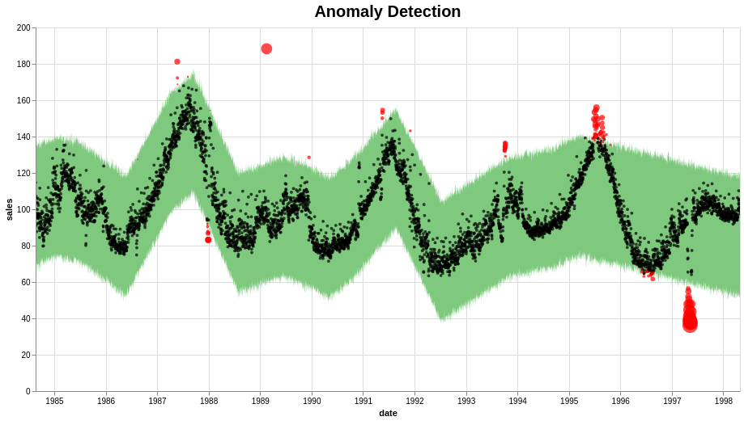
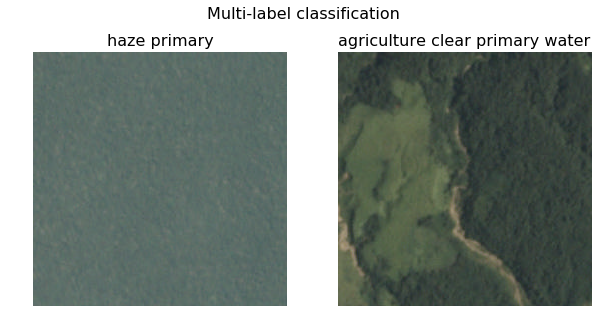
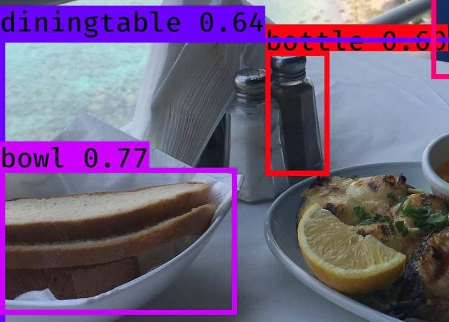

# Machine Learning and Deep Learning Scripts

Collection of useful Python scripts for Machine Learning and Deep Learning tasks, including Kaggle solutions, MOOC exercises, and practical implementations.

## Table of Contents

- [Classification](#classification)
- [Regression](#regression)
- [Statistics](#statistics)
- [Clustering](#clustering)
- [Time Series](#time-series)
- [Deep Learning](#deep-learning)
- [Natural Language Processing (NLP)](#natural-language-processing-nlp)
- [Recommendations](#recommendations)
- [Deployment](#deployment)
- [Contributing](#contributing)
- [License](#license)

## Classification

Machine learning classification algorithms and solutions.

Location: [`classification/`](./classification)

## Regression

Regression models and Kaggle competition solutions.

Location: [`regression/`](./regression)

## Statistics

Essential tools for statistical analysis: comparing medians, means, and data distributions for statistical significance.

Location: [`statistics/`](./statistics)

## Clustering

Useful cases and implementations for clustering tasks.

Location: [`clustering/`](./clustering)

## Time Series

Time series analysis and forecasting implementations.

Location: [`time series regression/`](./time%20series%20regression)

- **[Anomaly Detection](./time%20series%20regression/anomaly%20detection)** – Detection algorithms with [Medium article](https://medium.com/p/4c661f6f165f/)

  

- **[Deep Learning Approach](./time%20series%20regression/DL%20aproach%20for%20timeseries)** – Neural network models for time series

- **[ARIMA](./time%20series%20regression/ARIMA)** – Classical statistical methods

## Deep Learning

PyTorch, FastAI, and Keras implementations.

Location: [`DEEP LEARNING/`](./DEEP%20LEARNING)

### Images

- **Autoencoders & GANs**
  - [Tabular GANs](./DEEP%20LEARNING/Autoencoders%20GANS/GAN-for-tabular-data)
  - [Style Transfer](./DEEP%20LEARNING/Autoencoders%20GANS/Style%20transfer)

- **Image Classification**
  - [FastAI](./DEEP%20LEARNING/image%20classification/fastai)
  - [Keras](./DEEP%20LEARNING/image%20classification/keras)
  - [PyTorch](./DEEP%20LEARNING/image%20classification)

  

- **[Object Detection](./DEEP%20LEARNING/Object%20detection)**

  

- **[Segmentation](./DEEP%20LEARNING/segmentation)**
  - Kaggle solutions
  - [Segmentation Pipeline](./DEEP%20LEARNING/segmentation/Segmentation%20pipeline) with [Medium article](https://towardsdatascience.com/road-detection-using-segmentation-models-and-albumentations-libraries-on-keras-d5434eaf73a8)

  

- **[PyTorch Tutorials](./DEEP%20LEARNING/Pytorch%20from%20scratch)** – From scratch implementations

### Other DL Resources

- [Kaggle Avito Demand Prediction Challenge](./DEEP%20LEARNING/Kaggle%20Avito%20Demand%20Prediction%20Challenge)
- [Google Landmark Retrieval](./DEEP%20LEARNING/Google%20Landmark%20Retrieval%20Challenge.py)

## Natural Language Processing (NLP)

Text processing and NLP models.

Location: [`DEEP LEARNING/NLP/`](./DEEP%20LEARNING/NLP)

## Recommendations

Recommendation systems and collaborative filtering.

Location: [`recommendations/`](./recommendations)

- [ODS Course materials](./recommendations/ods_course/)

## Deployment

Production deployment examples using Docker.

Location: [`deployment/`](./deployment)

## Books & Articles

Curated collection of learning resources.

Location: [`books, articles/`](./books%2C%20articles/)

## Contributing

Contributions are welcome! Please see [CONTRIBUTING.md](./CONTRIBUTING.md) for guidelines.

## Contact

- Telegram: [@ai_tablet](https://t.me/ai_tablet)
- GitHub: [@diyago](https://github.com/diyago)

## License

This project is licensed under the Apache License 2.0 - see the [LICENSE](./LICENSE) file for details.
